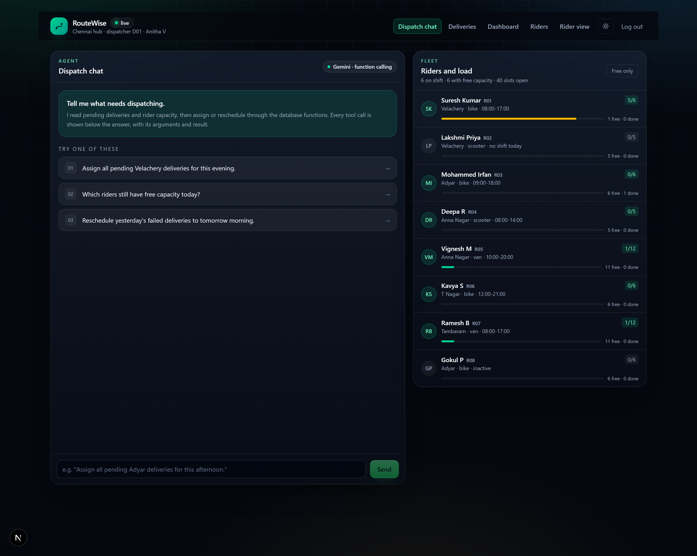
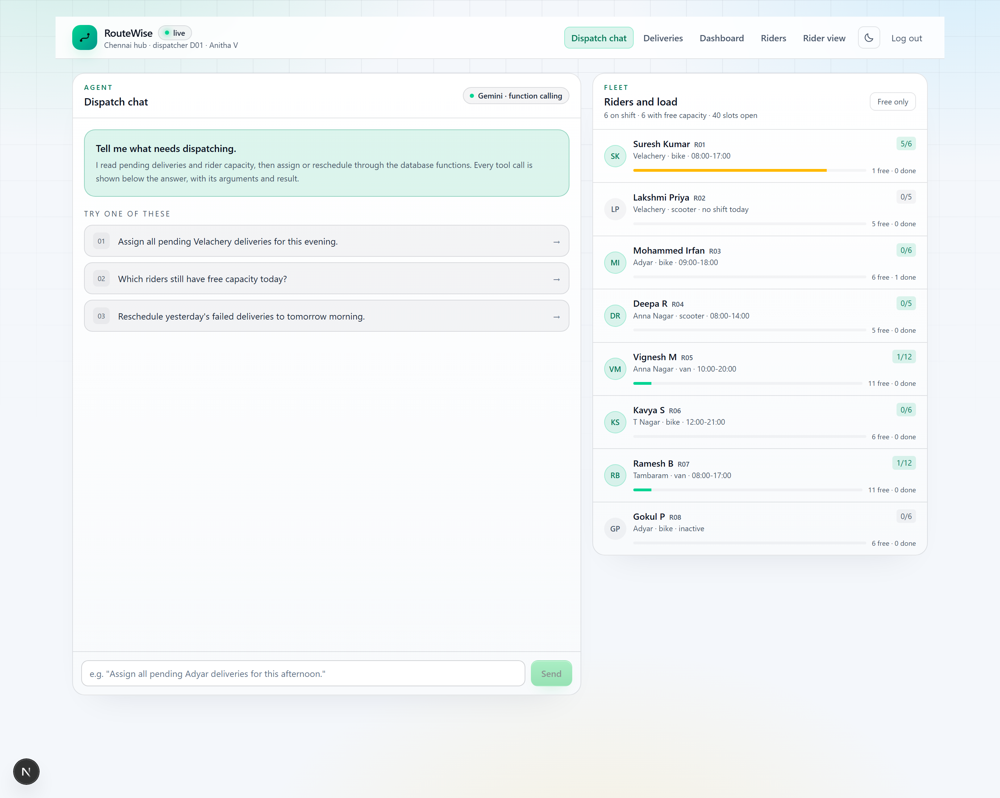
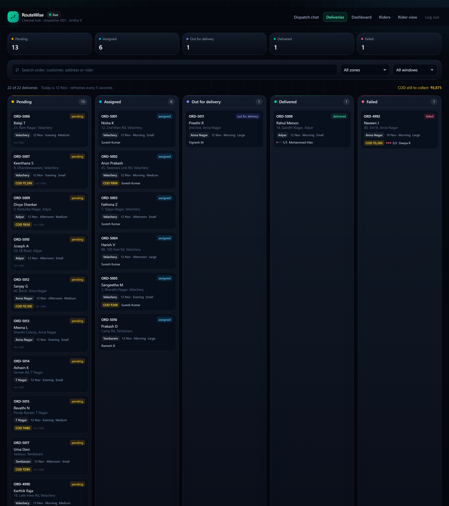
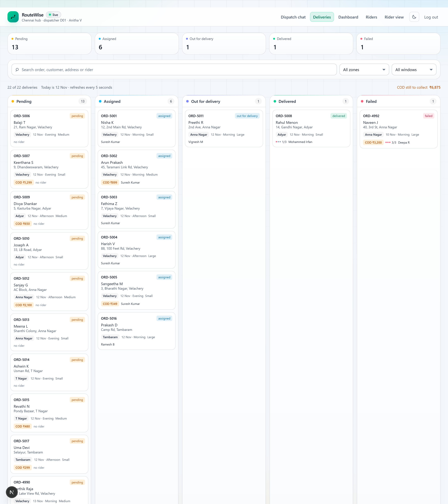
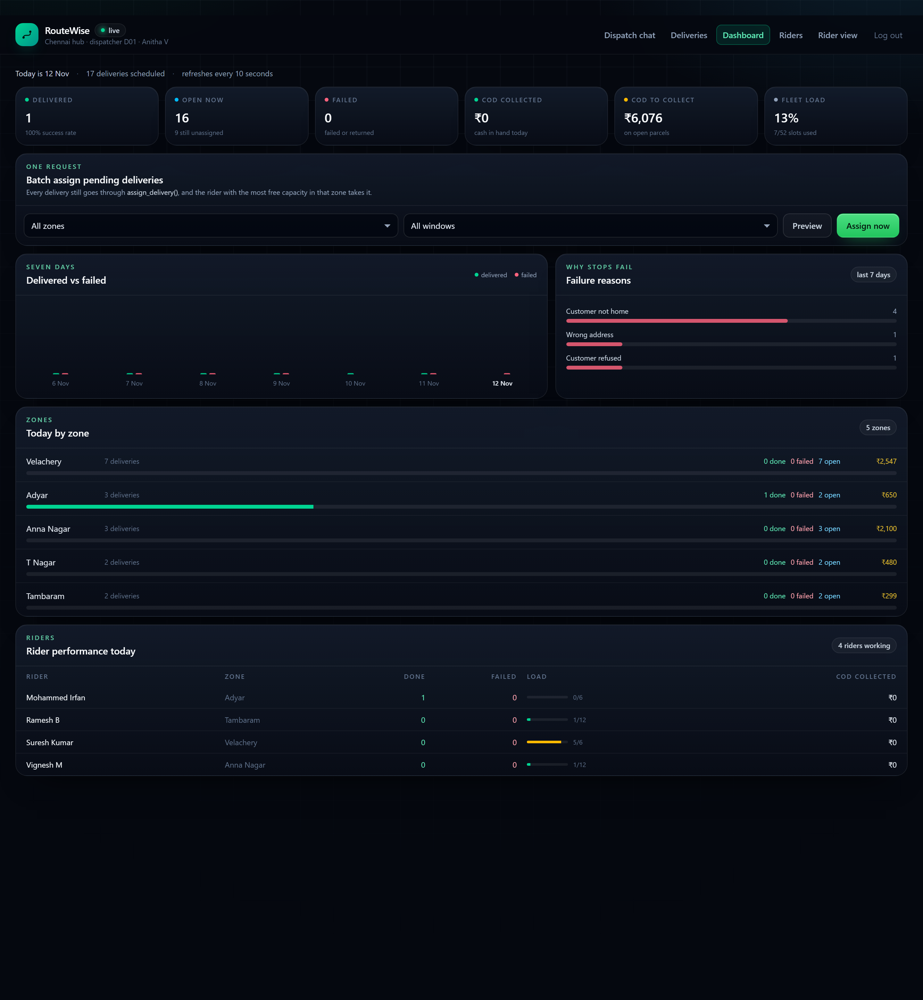
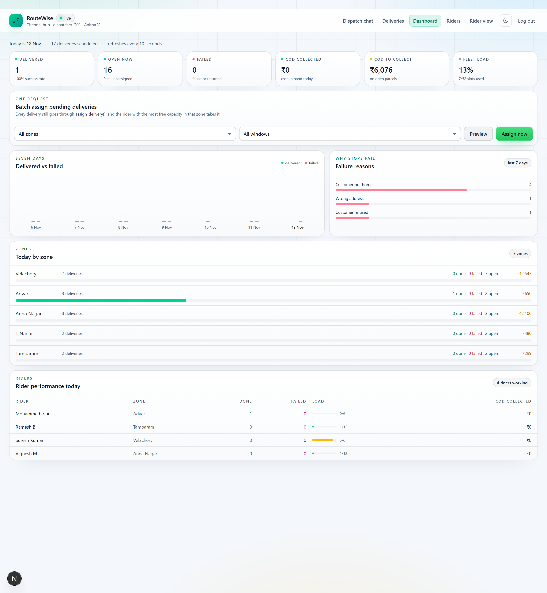
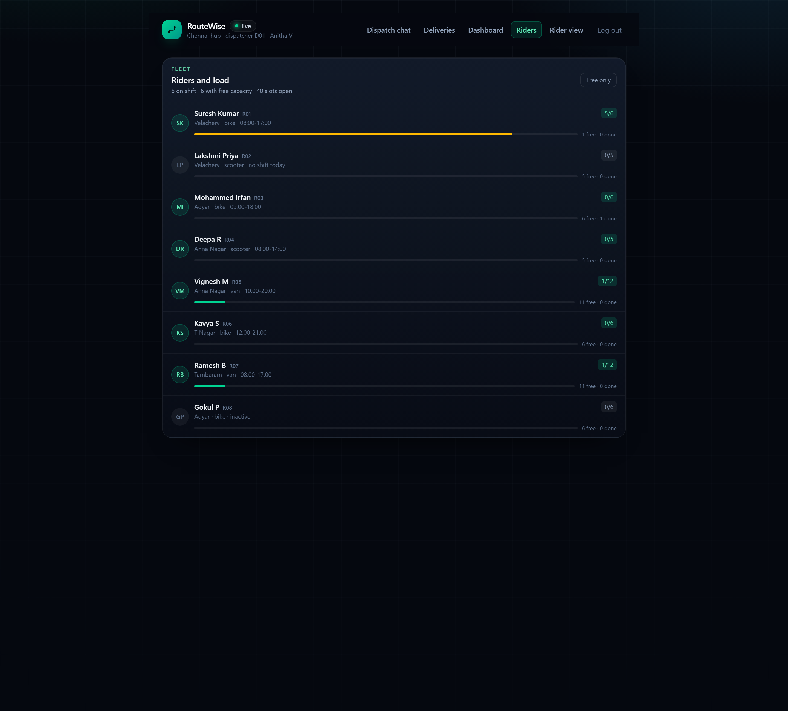
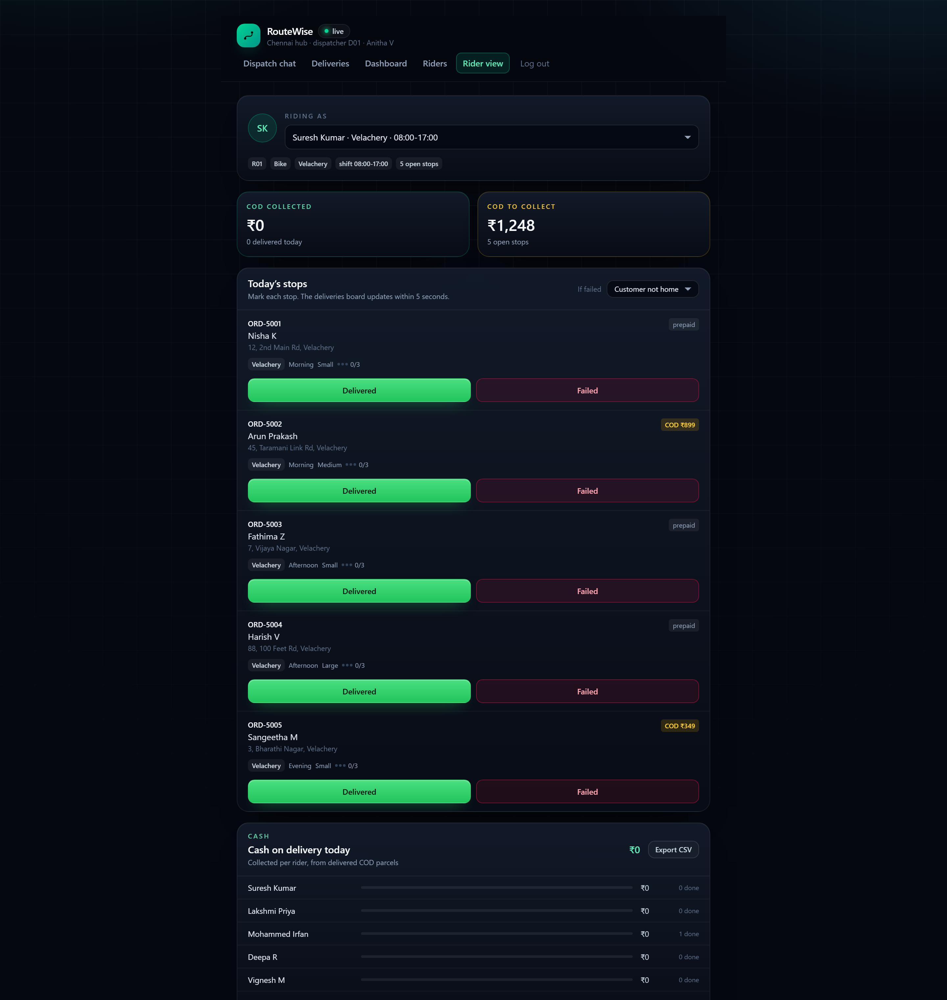
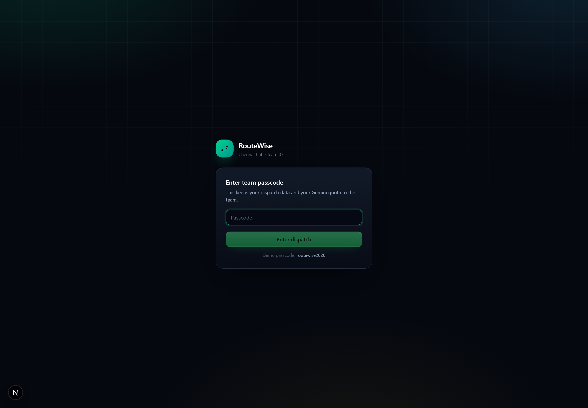

# RouteWise — Delivery Dispatch Agent

**VisionX · Team 07 · Problem Statement 7 (PS7) · SRM Agentic AI Hackathon**

A dispatcher at a Chennai delivery hub assigns every parcel to a rider by hand from a spreadsheet.
Riders get overloaded while others sit idle, riders are sent into areas they do not cover, and failed
deliveries are forgotten instead of being rescheduled. **RouteWise** replaces that spreadsheet with an
agent that does the dispatch work: the dispatcher asks in plain English, and every write goes through
the database functions that hold the business rules.

| Team member | Roll number | Role |
| --- | --- | --- |
| Yadhunandh K | RA24110026010949 | Team lead · agent, API and deployment |
| Abhishek S B | RA241100301243 | Database, business rules and data |
| Alok Ramteke | RA2411003012526 | Frontend and design system |
| Nikhil Kumar Dev | RA2411003012594 | Rider flow, testing and documentation |

---

## 1. Project overview and live demo

| | |
| --- | --- |
| **Live app (Vercel)** | https://routewise-ps7.vercel.app |
| **Passcode** | `routewise2026` |
| **Source** | https://github.com/yadhu49/team-07-ps7 |
| **Logged-in user** | dispatcher `D01`, Anitha V (Chennai hub) |
| **Audience** | hub dispatchers (chat + board), riders (rider view), hub supervisors (dashboard) |

### What the app does

- **Talks dispatch.** The dispatcher types “Assign all pending Velachery deliveries for this evening.” and the agent reads pending deliveries, checks rider shifts and capacity, assigns them, and explains what it could not move.
- **Respects the rules.** Every assignment goes through `assign_delivery()` and every reschedule through `reschedule_delivery()`, so pending-only, same-zone, on-shift, capacity and 3-attempt rules are enforced by Postgres, not by the model.
- **Shows its work.** Each tool call is listed under the answer with its arguments and result, so judges and dispatchers can audit the agent.
- **Five screens:** dispatch chat, deliveries board, supervisor dashboard, riders, rider view.
- **One-request batch assign.** Assign every pending delivery in a zone and time window in a single call, spread across the riders with the most free capacity, with a dry-run preview.
- **Rider view.** A rider marks each stop delivered or failed (with a failure reason) and sees their cash-on-delivery totals; the supervisor sees the same numbers per rider and can export them as CSV.
- **Supervisor dashboard.** Today’s delivered / open / failed counts, success rate, COD collected and pending, fleet load, a seven-day delivered-vs-failed chart, per-zone progress, rider performance and failure reasons.
- **Light and dark themes.** One click in the header switches the whole interface; the choice is remembered per browser.

### Screenshots

| Dark (default) | Light |
| --- | --- |
|  |  |
|  |  |
|  |  |

| | |
| --- | --- |
|  |  |
|  | Rider view — COD collected, today’s stops, delivered / failed |

All screenshots are 1440 px desktop captures at 2× density in [`docs/screenshots`](docs/screenshots).

---

## 2. Tech stack and architecture

| Layer | Choice | Why |
| --- | --- | --- |
| Frontend | Next.js 16 App Router, React 19, TypeScript | One repo for screens and API, server components for pages |
| Styling | Tailwind CSS 4 + a token layer in `app/globals.css` | Dark/light themes swap CSS variables, no per-component theming |
| Validation | Zod 4 | Every tool argument and every API body is validated before it runs |
| Agent | Google Gemini via `@google/genai`, function calling | Seven tools, model picks them from natural language |
| Backend | Next.js route handlers (Node runtime) | Same deployment as the UI |
| Database | Supabase Postgres (Mumbai) | Relational rules, and the graded `assign_delivery()` / `reschedule_delivery()` functions |
| Auth | Signed passcode cookie checked in `proxy.ts` | Keeps the app and the Gemini quota to the team |
| Hosting | Vercel (production + preview deployments) | Zero-config Next.js, env vars per environment |

### Request flow

```
Browser (dispatcher)
  │  POST /api/agent  { messages }
  ▼
app/api/agent/route.ts  ──►  lib/agent/runAgent.ts  ──►  Gemini (function calling)
                                   │                        ▲
                                   │ tool call               │ result
                                   ▼                        │
                            lib/agent/tools.ts ─────────────┘
                              │ reads: pending, riders, load, failed
                              │ writes: supabase.rpc("assign_delivery" | "reschedule_delivery")
                              ▼
                        Supabase Postgres  (rules live in the SQL functions)
                              │
                              └──► screens poll /api/board, /api/rider, /api/dashboard every 5–10 s
```

Server-only code (`lib/`, `app/api/`) uses the Supabase secret key; the browser never sees it.
Row level security is on with no public policies, so only the server key can read or write.

---

## 3. Getting started (local development)

**Prerequisites:** Node.js 20+ (built on 22), npm 10+, a Supabase project, a Gemini API key.

```bash
# 1. clone
git clone https://github.com/yadhu49/team-07-ps7.git
cd team-07-ps7

# 2. install
npm install

# 3. configure
cp .env.example .env.local     # then fill in the five values below

# 4. create the schema, seed data and both database functions
#    Supabase → SQL Editor → paste the whole of seed/ps7_delivery_dispatch.sql → Run

# 5. run
npm run dev                    # http://localhost:3000, passcode from APP_PASSCODE
```

Other scripts: `npm run build` (production build), `npm start` (serve the build), `npm run typecheck`.
Health check: open `/api/health` — it lists the missing settings and whether the tables exist.

### Environment variables

Copy [`.env.example`](.env.example) to `.env.local`. It is git-ignored; never commit real keys.

| Variable | Required | Description |
| --- | --- | --- |
| `GEMINI_API_KEY` | yes | Google AI Studio key used for function calling. Keep it server-side. |
| `GEMINI_MODEL` | yes | Model name, e.g. `gemini-3.5-flash`. Use the model your key has access to. |
| `SUPABASE_URL` | yes | Project URL, up to `.supabase.co`. |
| `SUPABASE_SECRET_KEY` | yes | Supabase `service_role` key. Server only — it bypasses RLS. |
| `APP_PASSCODE` | yes | Passcode that gates the app and protects the Gemini quota. |

---

## 4. Deployment and Vercel configuration

1. **Import.** Vercel → *Add New Project* → import the GitHub repo. Framework preset is detected as **Next.js**.
2. **Build settings.**

   | Setting | Value |
   | --- | --- |
   | Install Command | `npm install` |
   | Build Command | `npm run build` |
   | Output Directory | `.next` (default — do not override) |
   | Node.js Version | 22.x |
   | Root Directory | repository root |

3. **Environment variables.** Project → *Settings* → *Environment Variables* → add the five keys above for **Production** (and **Preview** if you want previews to work). Mark `SUPABASE_SECRET_KEY`, `GEMINI_API_KEY` and `APP_PASSCODE` as *Sensitive*. Redeploy after adding them — Vercel only reads env vars at build/run time.
4. **Deploy.** `vercel --prod` from the CLI, or *Deploy* in the dashboard. The production URL is https://routewise-ps7.vercel.app.
5. **Preview deployments.** Every pull request and every non-production branch push gets its own preview URL automatically. Keep the passcode gate on so previews are not public dispatch consoles.
6. **Protection.** Deployment protection is disabled for this project so judges can reach it with only the passcode.

Local CLI equivalent: `vercel --prod --yes --team <team>`. The build is also reproducible offline with `npm run build`.

---

## 5. Project structure

```
.
├── app/
│   ├── layout.tsx                Root layout, fonts, pre-paint theme script
│   ├── globals.css               Design tokens (dark/light), cards, buttons, inputs, chips
│   ├── page.tsx                  Dispatch chat + live rider load
│   ├── login/page.tsx            Passcode gate
│   ├── board/page.tsx            Deliveries board (5 statuses)
│   ├── dashboard/page.tsx        Supervisor dashboard + batch assign panel
│   ├── riders/page.tsx           Fleet with load and shifts
│   ├── rider/page.tsx            Rider view: mark delivered/failed, COD totals
│   └── api/
│       ├── agent/route.ts        POST /api/agent — runs the dispatcher agent
│       ├── board/route.ts        GET  /api/board — deliveries + riders for the screens
│       ├── rider/route.ts        GET rider summaries + COD, POST mark delivered/failed
│       ├── dashboard/route.ts    GET hub KPIs, zones, riders, 7-day trend, failure reasons
│       ├── batch-assign/route.ts POST assign every matching pending delivery
│       ├── login/route.ts        POST passcode → signed session cookie
│       ├── logout/route.ts       POST clear the session
│       └── health/route.ts       GET which settings/tables are missing
├── components/
│   ├── AppHeader.tsx             Brand, nav, theme toggle, logout
│   ├── ThemeToggle.tsx           Dark ⇄ light switch, persisted in localStorage
│   ├── AgentChat.tsx             Chat, tool-call cards, prompt suggestions
│   ├── DeliveriesBoard.tsx       Status columns, search, zone/window filters
│   ├── RidersPanel.tsx           Fleet list with load bars
│   ├── RiderView.tsx             Rider stops, delivered/failed, COD, CSV export
│   └── SupervisorDashboard.tsx   KPIs, trend chart, zones, riders, batch assign
├── lib/
│   ├── agent/
│   │   ├── tools.ts              The seven agent tools (reads + writes)
│   │   ├── defineTool.ts         Zod schema → Gemini function declaration
│   │   ├── runAgent.ts           Agent loop, max 8 rounds, 503/429 retry
│   │   ├── systemPrompt.ts       Dispatcher instructions, today's date
│   │   └── types.ts              AgentStep / AgentResult DTOs
│   ├── batchAssign.ts            Batch assign service (endpoint + agent tool)
│   ├── supabase.ts               Server-only Supabase client (secret key)
│   ├── auth.ts                   Session cookie signing and validation
│   ├── dates.ts                  India date helpers
│   ├── env.ts                    Required-env reader
│   ├── schemas.ts                Shared Zod schemas (ISO date)
│   └── types.ts                  DTOs shared by API routes and screens
├── seed/ps7_delivery_dispatch.sql  Tables, seed data, DB functions, RLS
├── docs/screenshots/             Desktop captures used in this README
├── proxy.ts                      Passcode gate for pages and APIs
├── next.config.ts                Turbopack root, worker count
├── .env.example                  Environment template
└── AGENTS.md                     Rules for humans and AI tools working here
```

---

## 6. API routes and core logic

| Route | Purpose |
| --- | --- |
| `POST /api/agent` | Runs the agent: sends the chat history to Gemini with the seven tool declarations, executes the tool calls, returns `{ reply, steps }`. |
| `GET /api/board` | Today's deliveries, status counts and every rider's load for the board and fleet screens. |
| `GET /api/rider` | Per-rider open stops, COD collected, COD still to collect, delivered count. |
| `POST /api/rider` | A rider marks one of **their own** stops `delivered` or `failed`, with a failure reason; increments attempts, writes a `delivery_attempts` row. |
| `GET /api/dashboard` | Today's totals, zone and rider performance, seven-day trend, failure reasons. |
| `POST /api/batch-assign` | `{ zone?, time_window?, delivery_date?, dry_run? }` → assigns every matching pending delivery and returns `{ assigned, unassigned, summary }`. |
| `POST /api/login`, `POST /api/logout` | Passcode session. |
| `GET /api/health` | Configuration and schema check. |

### Agent tools

| Tool | What it does | Writes |
| --- | --- | --- |
| `getPendingDeliveries` | Pending deliveries for a date, filterable by zone and window | — |
| `getAvailableRiders` | Active riders with a shift: zone, hours, load, free capacity, window coverage | — |
| `getRiderLoad` | Every rider's load, capacity, shift and deliveries completed today | — |
| `getFailedDeliveries` | Failed deliveries with attempts used and whether a retry is allowed | — |
| `assignDelivery` | One delivery to one rider via `assign_delivery()` | yes |
| `batchAssignDeliveries` | Every matching pending delivery in one call, via `assign_delivery()` | yes |
| `rescheduleDelivery` | Move a failed delivery to a new date/window via `reschedule_delivery()` | yes |

### Business rules (enforced in Postgres)

1. A delivery can be assigned only while its status is `pending`.
2. A rider can take deliveries only in their own `home_zone`.
3. A rider can take deliveries only on a day with a `rider_shifts` row.
4. A rider can hold at most `riders.capacity` active deliveries (`assigned` or `out_for_delivery`).
5. A delivery can have at most 3 attempts; a failed delivery must be rescheduled before it can be assigned again.

`assign_delivery()` and `reschedule_delivery()` check all five and raise readable errors. TypeScript never
updates `deliveries`, `riders` or `rider_shifts` directly — the only exception is the rider's guarded
mark-delivered/failed update, which is scoped to their own delivery and current status.

### Database

`zones`, `riders`, `rider_shifts`, `deliveries`, `delivery_attempts`. Seed data: 5 Chennai zones, 8 riders,
11 shifts, 22 deliveries, 7 attempts. Run [`seed/ps7_delivery_dispatch.sql`](seed/ps7_delivery_dispatch.sql) once.

### Theme

`app/globals.css` defines every colour as a CSS variable on `:root[data-theme="dark"]` and
`[data-theme="light"]`; Tailwind exposes them as tokens (`text-fg`, `bg-elev`, `border-line`,
`bg-tint-success`, …). `components/ThemeToggle.tsx` flips `data-theme` and stores the choice in
`localStorage`, and an inline script in `app/layout.tsx` applies it before first paint so there is no flash.

---

## Demo script for judges

1. `Assign all pending Velachery deliveries for this evening.` — the agent calls `getPendingDeliveries`, `getAvailableRiders`, `getRiderLoad`, then `batchAssignDeliveries`; the board changes.
2. `Which riders still have free capacity today?` — read-only fleet view.
3. `Reschedule yesterday's failed deliveries to tomorrow morning.` — two move; the delivery with 3 attempts is refused by the database function.
4. **Dashboard** → choose a zone → **Preview**, then **Assign now**; watch the KPIs and the zone bars update.
5. **Rider view** → pick R01 → **Delivered**: the board and the COD totals update; **Failed** counts an attempt and is refused after three.
6. Toggle the theme in the header.

## Roadmap

- Move the rider mark into a `mark_delivery()` Postgres function so every write path is a DB function.
- Supabase Realtime instead of 5-second polling.
- Route optimisation and ETA per rider using zone pincodes.
- Proof-of-delivery photos in Supabase Storage.
- Customer notifications (WhatsApp/SMS) when a parcel goes out for delivery.
- Dispatcher and rider logins with roles instead of one shared passcode.

## Troubleshooting

| Symptom | Fix |
| --- | --- |
| `Model not found` | Set `GEMINI_MODEL` to a model your key can use and redeploy. |
| `relation "deliveries" does not exist` | Run the seed SQL in Supabase. |
| `Invalid API key` from Supabase | `SUPABASE_URL` and `SUPABASE_SECRET_KEY` must come from the same project; use the `service_role` key. |
| Agent replies without calling a tool | Check the tool descriptions and `lib/agent/systemPrompt.ts`. |
| Build killed on a small machine | `NODE_OPTIONS=--max-old-space-size=3072 npm run build`. |
