# RouteWise — Delivery Dispatch Agent

**VisionX · Team 07 · Problem Statement 7 · SRM Agentic AI Hackathon**

| Team member | Roll number | Responsibility |
| --- | --- | --- |
| Yadhunandh K | RA24110026010949 | Team lead · agent loop, API routes, deployment |
| Abhishek S B | RA241100301243 | Database schema, business-rule functions, seed data |
| Alok Ramteke | RA2411003012526 | Frontend, design system, light/dark themes |
| Nikhil Kumar Dev | RA2411003012594 | Rider flow, QA, documentation |

**Live application:** https://routewise-ps7.vercel.app · **Access passcode:** `routewise2026`

---

## 1. Project Overview & Live Demo

### 1.1 The problem

A dispatcher at a city delivery hub assigns every parcel to a rider by hand from a spreadsheet. Three
things go wrong every day:

1. **Unbalanced load.** One rider holds nine parcels while another finishes at noon with four free slots.
2. **Wrong area.** Riders are sent into zones they do not cover, so addresses are found late or not at all.
3. **Forgotten failures.** A failed delivery is marked "failed" and never retried, because nobody owns the follow-up.

### 1.2 The solution

RouteWise is a dispatch agent for the hub. The dispatcher states the intent in plain English; the agent reads
the real delivery list and the real fleet, then performs the dispatch through database functions that enforce
every business rule. Nothing is typed into a spreadsheet.

> Dispatcher: *"Assign all pending Velachery deliveries for this evening."*
> RouteWise: calls `getPendingDeliveries` → `getAvailableRiders` → `getRiderLoad` → `batchAssignDeliveries`,
> reports what it assigned, what is still pending and the exact reason it could not move the rest.

The app has six screens behind one passcode gate: a passcode screen, the dispatch chat, the deliveries board,
the supervisor dashboard, the rider fleet, and the rider view.

### 1.3 Links

| | |
| --- | --- |
| **Live deployment (Vercel)** | https://routewise-ps7.vercel.app |
| **Source repository (GitHub)** | https://github.com/yadhu49/team-07-ps7 |
| **Passcode** | `routewise2026` |
| **Logged-in user** | dispatcher `D01`, Anitha V — Chennai hub |
| **Model** | Google Gemini 3.5 Flash, function calling |

### 1.4 Key features

| Feature | Description |
| --- | --- |
| **Agentic dispatch chat** | Natural-language dispatch. Seven tools (four read, three write); every tool call, its arguments and its result are shown under the answer so the work is auditable. |
| **Rules enforced in Postgres** | `assign_delivery()` and `reschedule_delivery()` check pending-only, same-zone, on-shift, capacity and the 3-attempt limit. The model cannot bypass them. |
| **Batch assign** | One request assigns every pending delivery in a zone and time window, spreading them over the riders with the most free capacity. Dry-run preview available. |
| **Deliveries board** | Five live status columns (pending, assigned, out for delivery, delivered, failed/returned) with search, zone and time-window filters and a COD-to-collect figure. |
| **Supervisor dashboard** | Delivered / open / failed counts, success rate, COD collected and pending, fleet load, seven-day delivered-vs-failed chart, per-zone progress, rider performance, failure reasons. |
| **Rider view** | A rider marks each stop delivered or failed (with a failure reason), sees COD collected and COD to collect, and the supervisor can export the day's COD report as CSV. |
| **Light & dark themes** | One-click switch in the header, remembered per browser, applied before first paint so there is no flash. |
| **Passcode gate** | Signed session cookie checked for every page and API route, protecting dispatch data and the Gemini quota. |

### 1.5 Target audience

| User | What they do in RouteWise |
| --- | --- |
| **Hub dispatcher** (primary) | Talks to the agent, watches the board, assigns and reschedules |
| **Hub supervisor** | Reads the dashboard, runs batch assign, exports COD figures |
| **Delivery rider** | Opens the rider view on a phone, marks stops delivered or failed |
| **Hackathon judges** | Audit the tool calls, the database rules and the live screens |

### 1.6 Screenshots — dark theme (default)

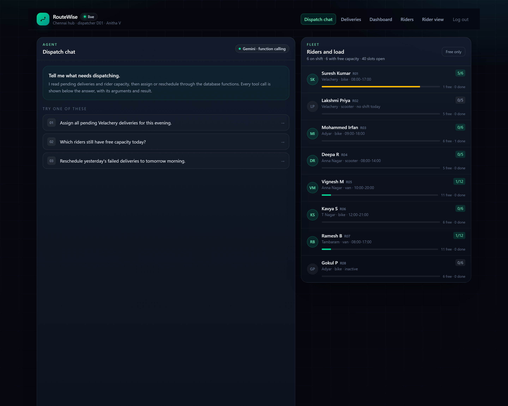

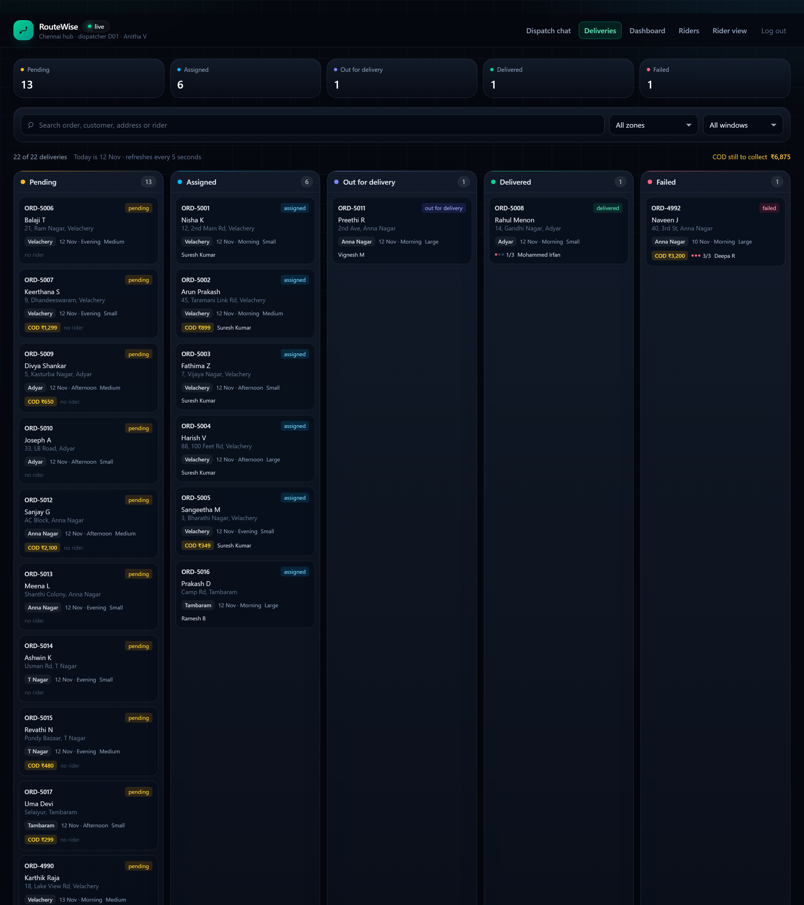

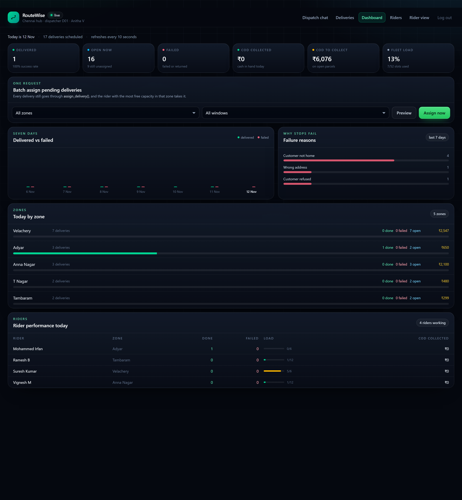

### 1.7 Rider screens

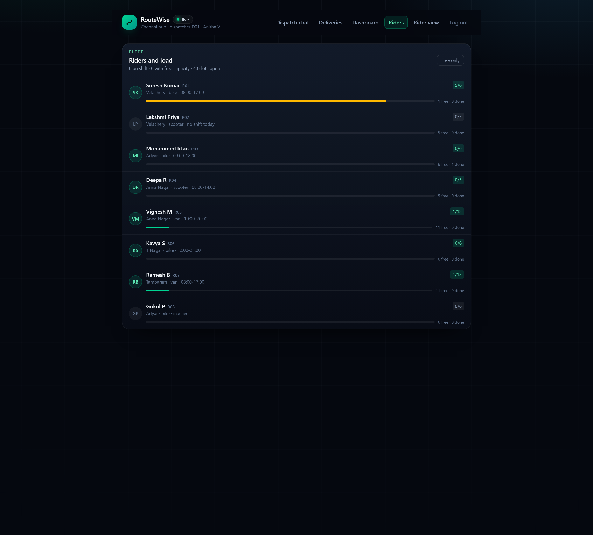

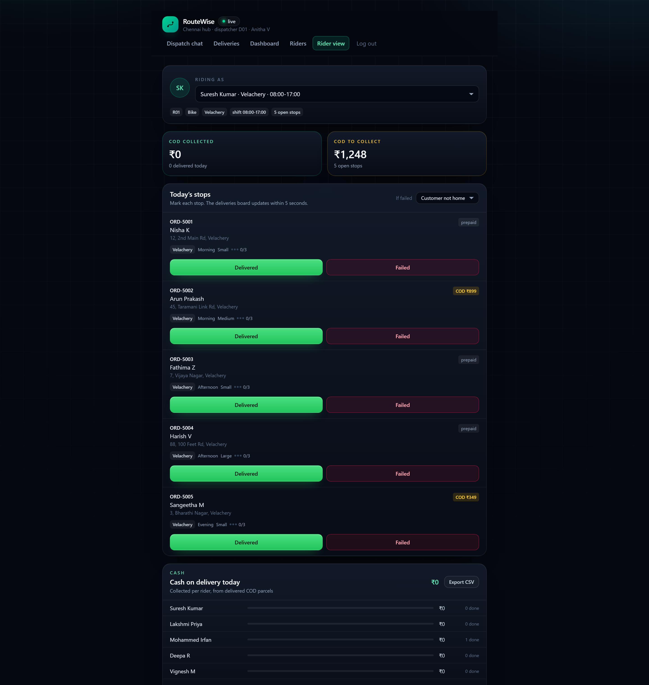

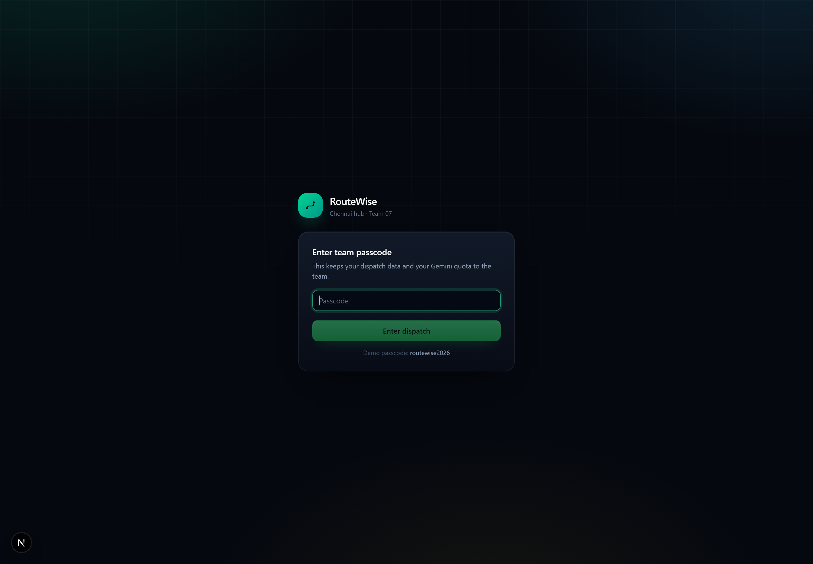

### 1.8 Screenshots — light theme

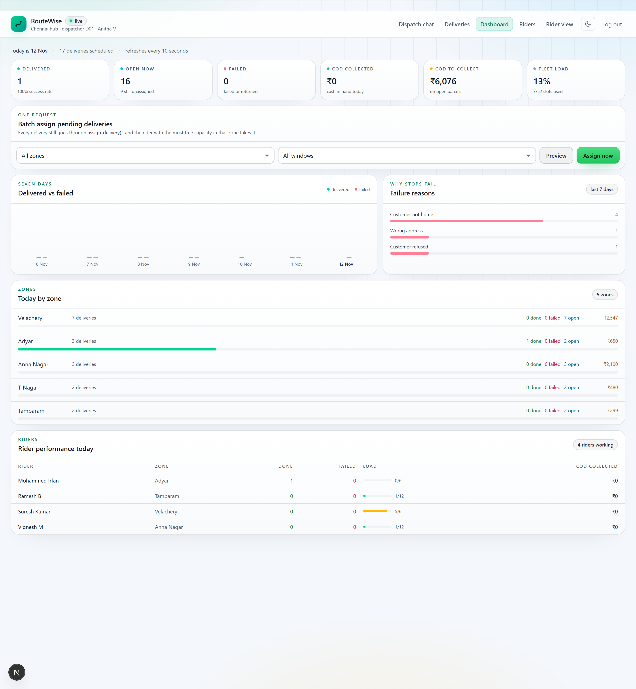

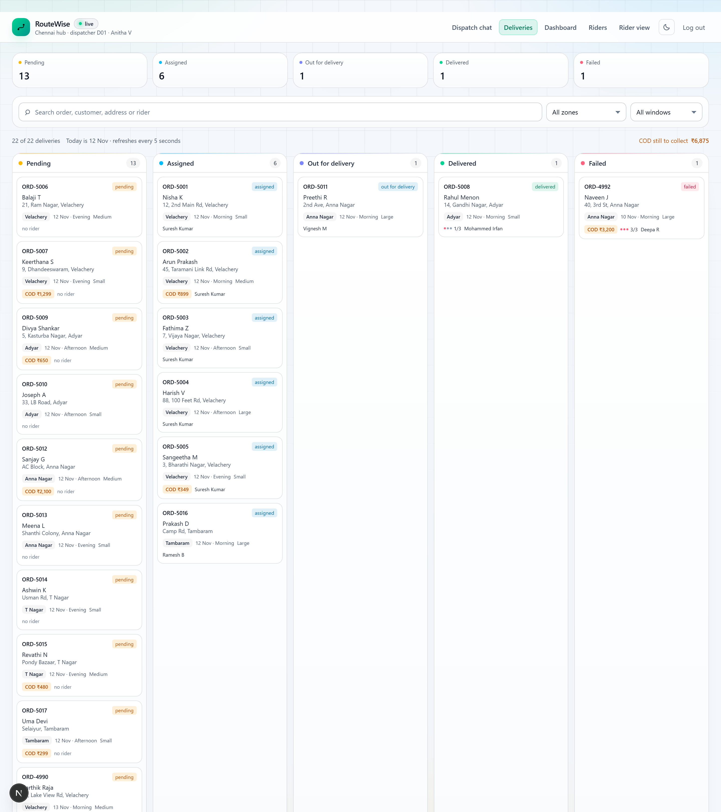

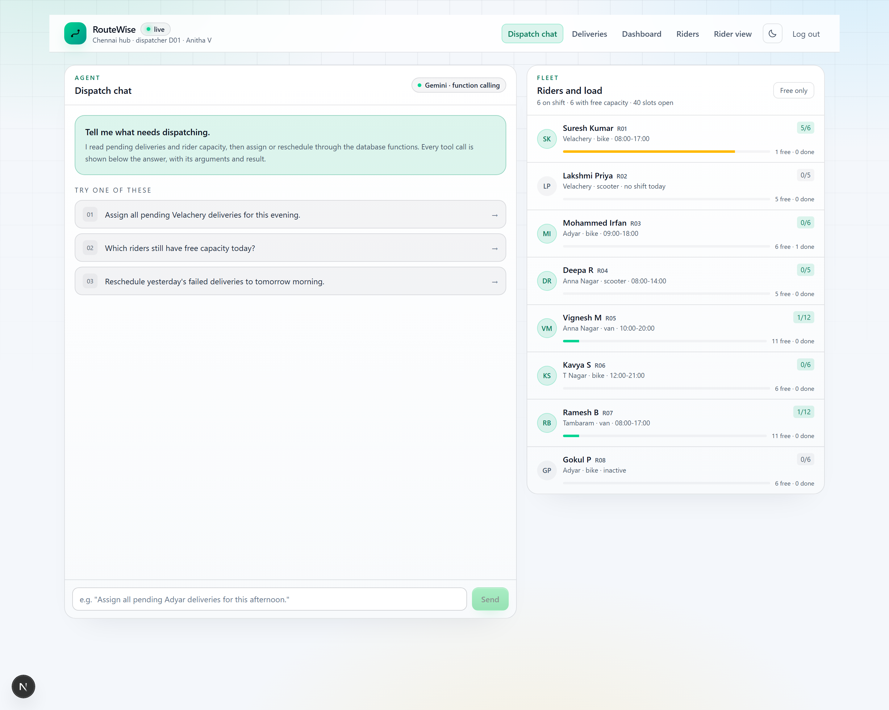

---

## 2. Tech Stack & Architecture

### 2.1 Stack

| Layer | Technology | Why this choice |
| --- | --- | --- |
| **Frontend** | Next.js 16 (App Router), React 19, TypeScript | One codebase for screens and server routes; server-rendered pages, client components only where interactivity is needed |
| **Styling** | Tailwind CSS 4 + a CSS-variable token layer in `app/globals.css` | Themes swap variables instead of rewriting components; a single design system for cards, buttons, inputs and chips |
| **Validation** | Zod 4 | Every tool argument and API body is validated before execution; the same schemas generate the Gemini function declarations |
| **Agent** | Google Gemini via `@google/genai`, function calling | The model chooses tools from natural language; our code performs every effect |
| **Backend** | Next.js route handlers (Node runtime) | Same deployment unit as the UI, no separate service to host |
| **Database** | Supabase Postgres (Mumbai region) | Relational integrity, and PL/pgSQL functions that hold the business rules |
| **Auth** | Passcode → signed, HTTP-only session cookie, verified in `proxy.ts` | Keeps the app and the Gemini quota to the team |
| **Hosting** | Vercel (production + preview) | Zero-config Next.js builds, per-environment secrets, preview URLs per PR |

### 2.2 Data flow

```
┌──────────────┐   POST /api/agent { messages }
│  Browser     │──────────────────────────────────────────┐
│  dispatcher  │                                          ▼
│              │                            ┌──────────────────────────┐
│  chat, board │                            │ app/api/agent/route.ts   │
│  dashboard,  │                            └───────────┬──────────────┘
│  rider view  │                                        ▼
│              │                            ┌──────────────────────────┐
│              │                            │ lib/agent/runAgent.ts    │  max 8 rounds
│              │                            │  (Gemini function call)  │  503/429 retry
│              │                            └───────┬─────────▲────────┘
│              │        { reply, steps }            │ tool    │ result
│              │◄───────────────────────────────────┘ call    │
└──────┬───────┘                                            ▼
       │ polls /api/board, /api/rider,          ┌──────────────────────────┐
       │ /api/dashboard every 5–10 s            │ lib/agent/tools.ts       │
       │                                        │  7 tools, Zod validated  │
       │                                        └───────────┬──────────────┘
       │                                                    │ reads
       │                                        writes       │
       │                                    supabase.rpc()   │
       │                                        ▼            ▼
       │                        ┌────────────────────────────────────────┐
       └───────────────────────►│  Supabase Postgres                     │
                                │  zones · riders · rider_shifts ·       │
                                │  deliveries · delivery_attempts        │
                                │  assign_delivery() · reschedule_...()  │
                                └────────────────────────────────────────┘
```

**Server/client boundary.** Everything under `lib/` and `app/api/` is server-only and uses the Supabase
secret key. The browser only ever receives JSON from our own routes. Row level security is enabled with no
public policies, so even a leaked anon key could not read the tables.

### 2.3 Database model

| Table | Purpose |
| --- | --- |
| `zones` | Chennai zones and their pincodes |
| `riders` | Rider, home zone, vehicle, capacity, active flag |
| `rider_shifts` | One row per rider per day, with start and end time |
| `deliveries` | Order reference, customer, address, zone, parcel size, COD, date, window, rider, status, attempts |
| `delivery_attempts` | Every attempt: rider, outcome, note, timestamp |

Seed data: 5 zones, 8 riders, 11 shifts, 22 deliveries, 7 attempts.

### 2.4 Business rules — enforced in the database

1. A delivery can be assigned only while its status is `pending`.
2. A rider can take deliveries only in their own `home_zone`.
3. A rider can take deliveries only on a day that has a `rider_shifts` row.
4. A rider can hold at most `riders.capacity` active deliveries (`assigned` or `out_for_delivery`).
5. A delivery can have at most 3 attempts; a failed delivery must be rescheduled before it can be assigned again.

Both functions raise plain-English errors, which the agent reads back to the dispatcher.

### 2.5 The theme system

Every colour is a CSS variable: `:root[data-theme="dark"]` and `[data-theme="light"]` define the same token
names (`--fg`, `--muted`, `--line`, `--elev`, `--surface`, `--tint-*`, …). Tailwind exposes them as utilities
(`text-fg`, `bg-elev`, `border-line`, `text-success`), and no component hard-codes a colour. The header toggle
flips `data-theme`, stores the choice in `localStorage`, and an inline script in the document head applies it
before the first paint.

---

## 3. Getting Started (Local Development)

### 3.1 Prerequisites

| Requirement | Version / note |
| --- | --- |
| Node.js | 20 or newer (developed on 22.x) |
| npm | 10 or newer (bundled with Node) |
| Supabase project | Free tier is enough; note the project URL and the `service_role` key |
| Gemini API key | Google AI Studio key with access to a Flash model |
| Git | Any recent version |

### 3.2 Clone and install

```bash
# 1. get the code
git clone https://github.com/yadhu49/team-07-ps7.git
cd team-07-ps7

# 2. install dependencies (lockfile is committed, keep it)
npm install

# 3. create the local environment file
cp .env.example .env.local
#    then open .env.local and fill in the five values described below
```

### 3.3 Create the database

Open the Supabase dashboard → **SQL Editor** → paste the entire contents of
[`seed/ps7_delivery_dispatch.sql`](../seed/ps7_delivery_dispatch.sql) → **Run**. It creates the five tables,
the seed data, both business-rule functions, and enables RLS.

### 3.4 Environment variables

The committed `.env.example` lists every key the app reads. `.env.local` is git-ignored — never commit real keys.

```dotenv
# Copy this file to .env.local and fill in your values.
# Never commit .env.local to GitHub.

# Google AI Studio -> Get API key (one key per team)
GEMINI_API_KEY=

# Gemini model name. Use the model your trainer gives you.
GEMINI_MODEL=gemini-3.5-flash

# Supabase -> Project Settings -> Project URL  (only up to .supabase.co)
SUPABASE_URL=

# Supabase -> Project Settings -> API Keys -> secret key (service_role)
# Server only. Never use this in frontend code.
SUPABASE_SECRET_KEY=

# Your team's passcode. It protects your app and your Gemini quota.
APP_PASSCODE=
```

| Variable | Required | Where to get it | Notes |
| --- | --- | --- | --- |
| `GEMINI_API_KEY` | yes | Google AI Studio | Server-side only; never exposed to the browser |
| `GEMINI_MODEL` | yes | Provided model name | e.g. `gemini-3.5-flash` |
| `SUPABASE_URL` | yes | Supabase → Project Settings → API | URL only, up to `.supabase.co` |
| `SUPABASE_SECRET_KEY` | yes | Supabase → API Keys → secret / `service_role` | Bypasses RLS — server only |
| `APP_PASSCODE` | yes | Chosen by the team | Gates pages and APIs, protects the quota |

### 3.5 Run it

```bash
npm run dev      # development server at http://localhost:3000
npm run build    # production build
npm start        # serve the production build
npm run typecheck  # TypeScript, no emit
```

Open http://localhost:3000, enter the passcode, and try
`Assign all pending Velachery deliveries for this evening.`
A configuration check is available at `/api/health`; it lists missing settings and whether the tables exist.

---

## 4. Deployment & Vercel Configuration

### 4.1 How the deployment works

The GitHub repository is connected to Vercel. Every push to `main` produces a production deployment, and
every other branch or pull request produces an isolated preview deployment. Vercel builds the Next.js app
with `npm run build` and serves the output from its edge network; the API routes run as serverless Node
functions.

### 4.2 Build settings

| Setting | Value |
| --- | --- |
| Framework preset | Next.js (auto-detected) |
| **Install Command** | `npm install` |
| **Build Command** | `npm run build` |
| **Output Directory** | `.next` (framework default — do not override) |
| Node.js Version | 22.x |
| Root Directory | repository root |
| Environment | Production (and Preview, if previews should run) |

### 4.3 Configuring environment variables securely

1. Vercel dashboard → select the project → **Settings → Environment Variables**.
2. Add each of the five keys (`GEMINI_API_KEY`, `GEMINI_MODEL`, `SUPABASE_URL`, `SUPABASE_SECRET_KEY`, `APP_PASSCODE`).
3. Scope them to **Production** (and **Preview** if you want working previews).
4. Mark `GEMINI_API_KEY`, `SUPABASE_SECRET_KEY` and `APP_PASSCODE` as **Sensitive** so they cannot be read back in the UI.
5. **Redeploy** — Vercel reads environment variables at build and runtime, so an existing deployment keeps the old values.
6. Never put keys in the repository, in client components, or in `NEXT_PUBLIC_*` variables.

The same values can be pushed from the CLI for a local machine: `vercel env add GEMINI_API_KEY production`.

### 4.4 Preview deployments

Any pull request from a branch in the repository receives its own URL
(`routewise-ps7-<hash>-<team>.vercel.app`). Preview deployments use the preview-scoped environment variables,
so a staging database or a staging key can be configured separately. Because the app is protected by the
passcode gate, previews are not open dispatch consoles. Deployment protection is disabled on this project
so judges can reach production with only the passcode.

### 4.5 Deploying from the CLI (what we actually ran)

```bash
vercel --prod --yes --team <team-slug>
```

Result: https://routewise-ps7.vercel.app — login returns 200, `/api/dashboard`, `/api/board` and
`/api/rider` return 200 with a session, and light mode renders from the deployed CSS bundle.

---

## 5. Project Structure

```
team-07-ps7/
├── app/                            Next.js App Router: pages + API route handlers
│   ├── layout.tsx                  Root layout, fonts, pre-paint theme script
│   ├── globals.css                 Design tokens (dark/light), cards, buttons, inputs, chips
│   ├── page.tsx                    "/" dispatch chat + live rider load
│   ├── login/page.tsx              Passcode gate screen
│   ├── board/page.tsx              "/board" deliveries board (five statuses)
│   ├── dashboard/page.tsx          "/dashboard" supervisor dashboard + batch assign
│   ├── riders/page.tsx             "/riders" fleet with load and shifts
│   ├── rider/page.tsx              "/rider" rider view: mark delivered/failed, COD
│   └── api/                        Server endpoints (Node runtime)
│       ├── agent/route.ts          POST /api/agent — run the dispatcher agent
│       ├── board/route.ts          GET  /api/board — deliveries + riders for the screens
│       ├── rider/route.ts          GET rider summaries + COD, POST mark delivered/failed
│       ├── dashboard/route.ts      GET hub KPIs, zones, riders, trend, failure reasons
│       ├── batch-assign/route.ts   POST assign every matching pending delivery
│       ├── login/route.ts          POST passcode → signed session cookie
│       ├── logout/route.ts         POST clear the session
│       └── health/route.ts         GET configuration and schema check
├── components/                     Client-side UI
│   ├── AppHeader.tsx               Brand, navigation, theme toggle, logout
│   ├── ThemeToggle.tsx             Dark ⇄ light switch, persisted in localStorage
│   ├── AgentChat.tsx               Chat, tool-call cards, prompt suggestions
│   ├── DeliveriesBoard.tsx         Status columns, search, zone/window filters
│   ├── RidersPanel.tsx             Fleet list with load bars and free-capacity filter
│   ├── RiderView.tsx               Rider stops, delivered/failed, COD totals, CSV export
│   └── SupervisorDashboard.tsx     KPIs, trend chart, zones, riders, batch assign panel
├── lib/                            Server-only logic (never bundled to the browser)
│   ├── agent/
│   │   ├── tools.ts                The seven agent tools (reads + writes)
│   │   ├── defineTool.ts           Zod schema → Gemini function declaration
│   │   ├── runAgent.ts             Agent loop: max 8 rounds, 503/429 retry
│   │   ├── systemPrompt.ts         Dispatcher instructions, today's date in India
│   │   └── types.ts                AgentStep / AgentResult DTOs
│   ├── batchAssign.ts              Batch assign service (endpoint + agent tool)
│   ├── supabase.ts                 Server-only Supabase client (secret key)
│   ├── auth.ts                     Session cookie signing and validation
│   ├── dates.ts                    India date helpers (YYYY-MM-DD)
│   ├── env.ts                      Required-environment reader
│   ├── schemas.ts                  Shared Zod schemas (ISO date)
│   └── types.ts                    DTOs shared by the API routes and the screens
├── seed/
│   └── ps7_delivery_dispatch.sql   Tables, seed data, DB functions, RLS
├── docs/
│   ├── REPORT.md                   This report
│   ├── report.html                 Printable version of this report
│   ├── RouteWise-Project-Report.pdf  PDF build of this report
│   └── screenshots/                Desktop and code captures used here
├── proxy.ts                        Passcode gate for pages and APIs
├── next.config.ts                  Turbopack root and worker count
├── .env.example                    Environment template (all five keys)
├── README.md                       Short project readme
└── AGENTS.md                       Conventions for humans and AI tools
```

---

## 6. API Routes / Core Logic

### 6.1 Endpoints

| Method & route | Request | Response | Notes |
| --- | --- | --- | --- |
| `POST /api/agent` | `{ messages: [{ role, text }] }` | `{ reply, steps[] }` | Runs Gemini with seven tool declarations; `steps` carries each tool call, arguments, result and whether it wrote |
| `GET /api/board` | — | `{ today, counts, deliveries[], riders[] }` | Feeds the board and the fleet panel |
| `GET /api/rider` | — | `{ today, riders[] }` | Per-rider open stops, COD collected, COD pending, delivered count |
| `POST /api/rider` | `{ delivery_id, rider_id, outcome, reason? }` | `{ delivery, attempts_left }` | 403 if the stop is not the rider's, 409 if the status is wrong or 3 attempts are used |
| `GET /api/dashboard` | — | `{ today, totals, zones[], riders[], trend[], reasons[] }` | Supervisor KPIs and the seven-day trend |
| `POST /api/batch-assign` | `{ zone?, time_window?, delivery_date?, dry_run? }` | `{ assigned[], unassigned[], summary }` | Assigns through `assign_delivery()`; `dry_run` previews |
| `POST /api/login` | `{ passcode }` | `{ ok: true }` + session cookie | Constant-time passcode comparison |
| `POST /api/logout` | — | `{ ok: true }` | Clears the session cookie |
| `GET /api/health` | — | settings and table checks | Used during setup |

### 6.2 The seven agent tools

| Tool | Purpose | Writes |
| --- | --- | --- |
| `getPendingDeliveries` | Pending deliveries for a date, optional zone and time window | no |
| `getAvailableRiders` | Active riders on shift: zone, hours, load, free capacity, window coverage | no |
| `getRiderLoad` | Every rider's load, capacity, shift and deliveries completed today | no |
| `getFailedDeliveries` | Failed deliveries with attempts used and whether a retry is allowed | no |
| `assignDelivery` | One delivery to one rider via `assign_delivery()` | yes |
| `batchAssignDeliveries` | Every matching pending delivery in one call, via `assign_delivery()` | yes |
| `rescheduleDelivery` | Move a failed delivery to a new date and window via `reschedule_delivery()` | yes |

Every argument is validated with Zod before the tool runs. Tool results are small objects; failures are
raised as plain-English errors, which the model reads and explains to the dispatcher.

### 6.3 Agent loop

`lib/agent/runAgent.ts` sends the conversation plus the function declarations to Gemini and executes the
returned tool calls, feeding results back, for at most **8 rounds**. Transient `503`/`429` responses are
retried. Every executed call is appended to `steps`, which the chat renders as expandable cards — so the
dispatcher, and the judges, can see exactly what happened.

### 6.4 Batch assign

`lib/batchAssign.ts` is shared by `POST /api/batch-assign` and the `batchAssignDeliveries` tool:

1. Resolve the zone (id or name) and the date (default: today in India).
2. Load every pending delivery for that date matching the zone and time window.
3. Load active riders with a shift that day, plus each rider's current active load.
4. For each delivery, pick the rider in the same zone with the **most free capacity** (ties broken by rider id).
5. Call `assign_delivery()` — capacity, zone, shift, status and attempt rules are re-checked by Postgres.
6. Return `{ assigned, unassigned, summary }`; `dry_run: true` produces the same plan without writing.

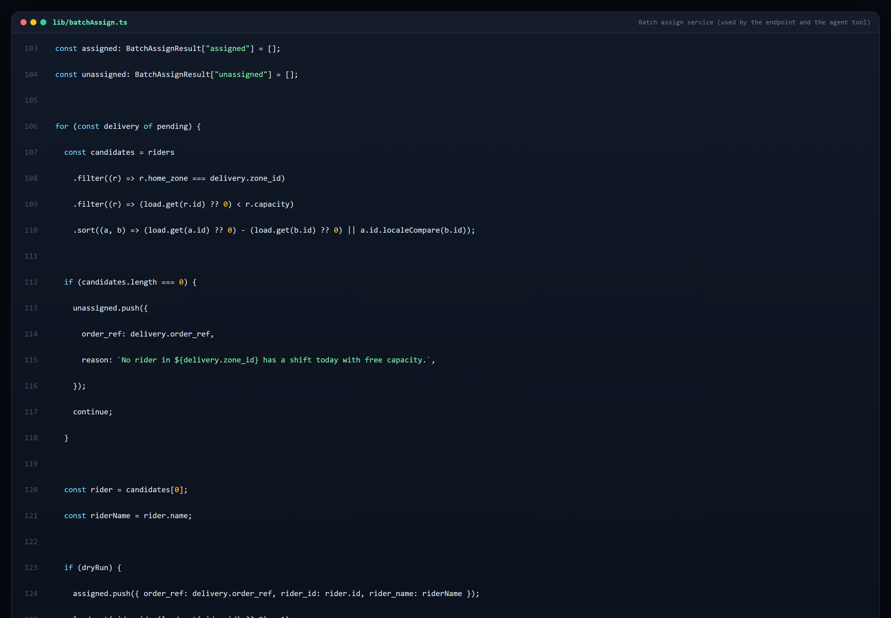

### 6.5 Rider marking guards

`POST /api/rider` refuses to mark a stop that is not assigned to the calling rider (403), that is no longer
active (409), or that already has three attempts (409). The update is guarded on `rider_id` **and** the
current status, so two taps cannot double-count, and each action writes a `delivery_attempts` row.

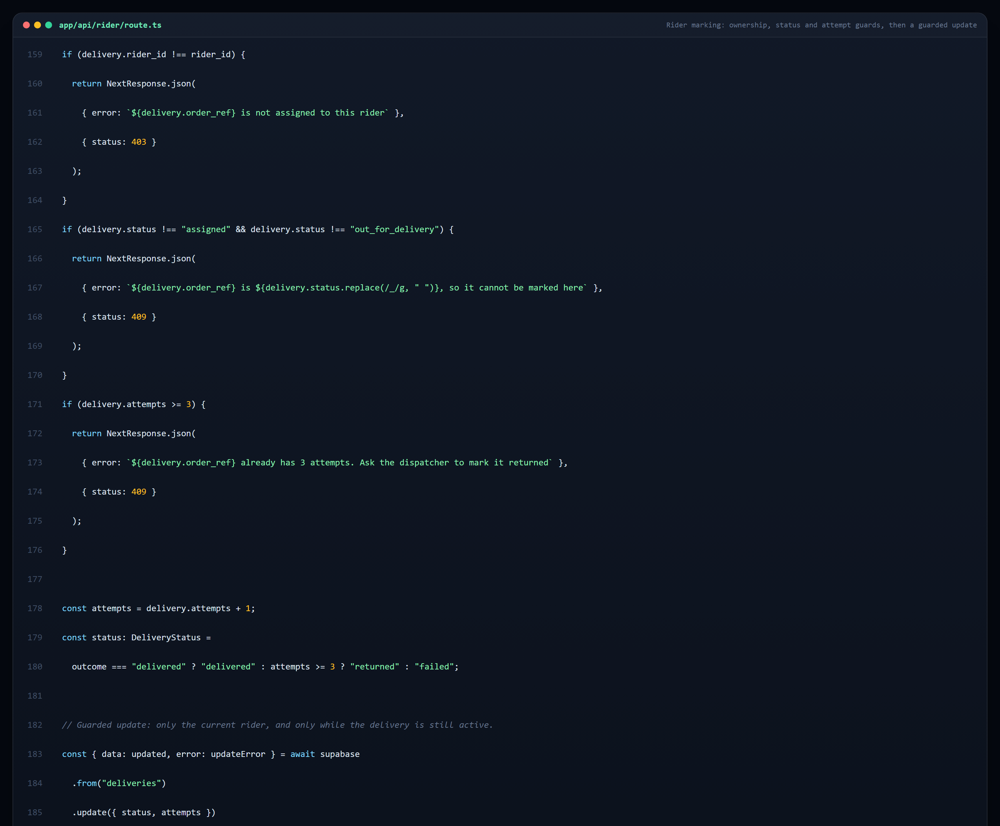

### 6.6 The database function the agent relies on

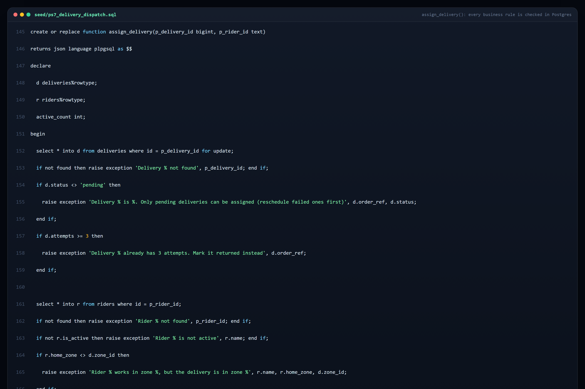

### 6.7 The batch tool declaration

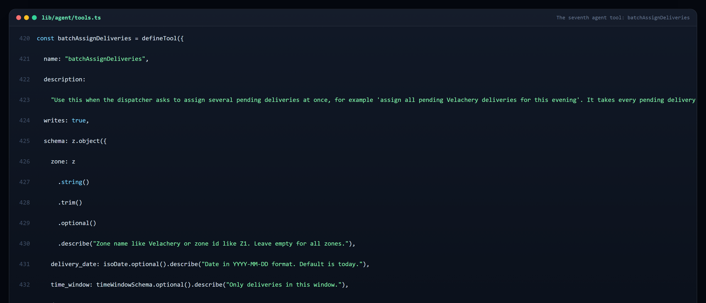

---

## Appendix A — Verification performed

| Check | Result |
| --- | --- |
| `npm run typecheck` | passes |
| `npm run build` | passes; routes include `/`, `/board`, `/dashboard`, `/riders`, `/rider`, `/login` and all eight APIs |
| Agent, assign prompt | `getPendingDeliveries` → `getAvailableRiders` → `getRiderLoad` → `assignDelivery`; a second assign to the same full rider is refused with *"Rider Suresh Kumar is full (6 of 6)"* |
| Agent, reschedule prompt | two failed deliveries moved; the one with 3 attempts refused by the database function |
| Batch assign (dry run) | `would assign 1 of 2 pending … ORD-5007: no rider in Z1 has a shift with free capacity` |
| Batch assign (real) | `ORD-5006 → R01`, confirmed in the database, then restored to `pending` |
| Unknown zone | HTTP 400 with the list of known zones |
| Rider view | delivered on a COD parcel raised COD collected to ₹899; failed incremented attempts; wrong-rider mark returned 403; data restored |
| Board and dashboard APIs | 200 with live data (22 deliveries, 5 zones, 8 riders) |
| Light/dark themes | `data-theme` switch verified in the browser and on the deployed site; body `#f4f7fb` in light, `#05080f` in dark |
| Production | login 200, `/dashboard` 200, `/api/dashboard` 200, `/api/board` 200, `/api/rider` 200 |

## Appendix B — Demo script for judges

1. `Assign all pending Velachery deliveries for this evening.` — the agent reads pending deliveries and the fleet, then batch-assigns; the board changes.
2. `Which riders still have free capacity today?` — read-only fleet view.
3. `Reschedule yesterday's failed deliveries to tomorrow morning.` — two move; the third is refused at 3 attempts.
4. **Dashboard** → pick a zone → **Preview**, then **Assign now**; the KPIs and zone bars update.
5. **Rider view** → R01 → **Delivered**: the board and COD totals update; **Failed** counts an attempt.
6. Toggle the theme in the header.

## Appendix C — Roadmap

- Move the rider mark into a `mark_delivery()` Postgres function so every write path is a database function.
- Replace 5-second polling with Supabase Realtime subscriptions.
- Route optimisation and ETA per rider using zone pincodes.
- Proof-of-delivery photos stored in Supabase Storage.
- Customer notifications (WhatsApp/SMS) when a parcel goes out for delivery.
- Separate dispatcher and rider logins with roles instead of one shared passcode.

## Appendix D — Troubleshooting

| Symptom | Fix |
| --- | --- |
| `Model not found` | Set `GEMINI_MODEL` to a model the key can use, then redeploy |
| `relation "deliveries" does not exist` | Run `seed/ps7_delivery_dispatch.sql` in the Supabase SQL editor |
| `Invalid API key` from Supabase | `SUPABASE_URL` and `SUPABASE_SECRET_KEY` must come from the same project; use the `service_role` key |
| Agent answers without calling a tool | Check the tool descriptions and `lib/agent/systemPrompt.ts` |
| Build runs out of memory on a laptop | `NODE_OPTIONS=--max-old-space-size=3072 npm run build` |
